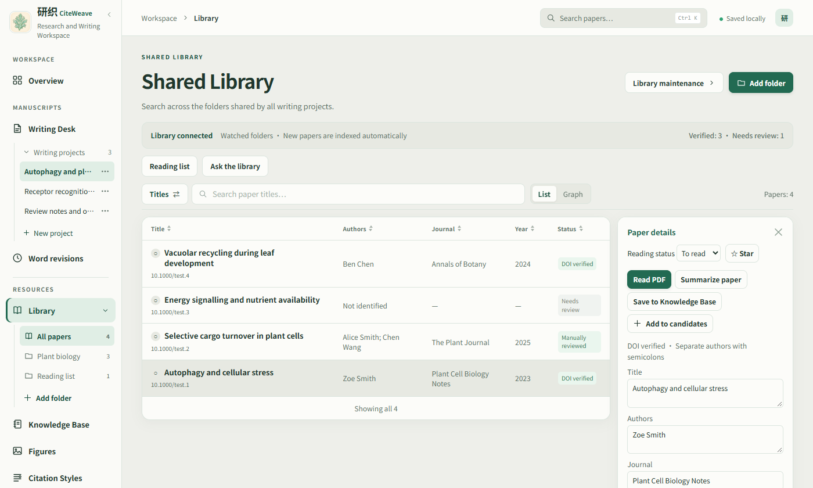
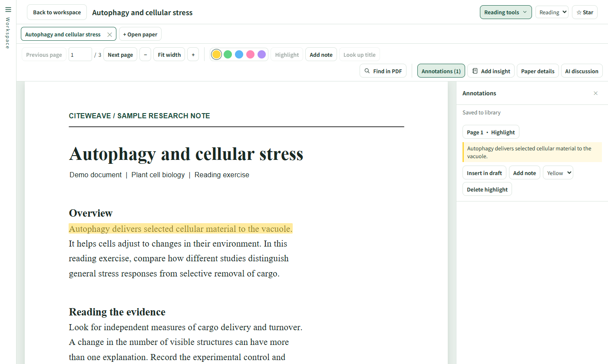
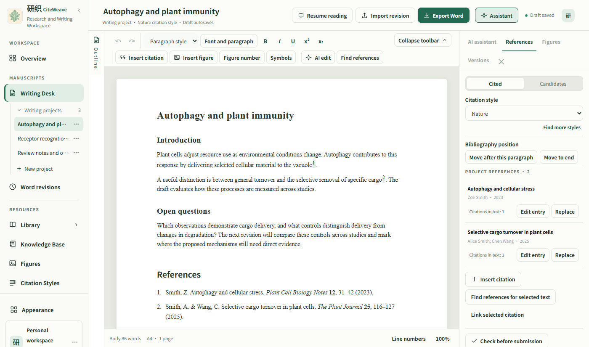

# 研织 · CiteWeave

研织是一款面向科研人员和研究生的本地文献与写作工作台。从找到一段原文、留下可追溯的批注，到写入文稿、整理参考文献和交给合作者修订，整个过程都可以在同一处完成。

CiteWeave is a local desktop workspace for researchers and graduate students. Find a passage in your PDF library, annotate it with its page reference, then carry that evidence into a manuscript and share the draft in Word.

[下载最新版 · Download](https://github.com/Alarics537/CiteWeave/releases/latest) · [双语快速入门 · Quick guide](QUICKSTART.md)

## 从检索到成稿 · From search to manuscript

### 共享文献库 · Shared PDF library

连接多个本地文件夹，研织会扫描子目录并监测新增 PDF。所有写作项目共用这套文献库。按题名或全文搜索，正文命中可查看原文片段并跳到对应页。识别到 DOI 后，可联网补全书目信息，也能在右栏逐项核对。

Watch multiple local folders, including subfolders, and share one library across writing projects. Search titles or indexed PDF text, review matching passages, and jump to the source page. Look up bibliographic details by DOI and review them alongside the paper list.

### 带出处的阅读笔记 · Reading notes with page links

在软件内同时打开多篇 PDF，搜索正文、使用彩色高亮并写笔记。批注可以带着引用插入文稿，也可在知识库里把多篇文献的阅读心得整理成一篇笔记，随时跳回原页。

Open several PDFs in tabs, search within a paper, and mark passages with colored highlights. Send an excerpt to a draft with its citation, or link notes on several papers in the knowledge base. Page links take you back to the source.

### 引用、版本与 Word 返修 · Citations, versions, and Word review

在写作台插入单篇或多篇合并引用，切换期刊样式时同步更新正文和参考文献表。可以按项目保留候选文献、替换已引用条目，并在大改前保存命名版本。把 Word 稿交给合作者后，导回研织检查正文改动、批注和引用。

Insert single or grouped citations and switch journal styles to update both in-text citations and the bibliography. Keep candidate papers for each project, replace cited sources, and save named versions before major edits. Export to Word and bring back a collaborator’s draft to review text changes, comments, and references.

*截图使用示例资料。 Screenshots use sample material.*

## 其他常用功能 · Also included

- **AI 辅助 · AI assistance** — 可连接 ChatGPT 总结文献、润色稿件，或根据文献库中检索到的片段提问。回答可附上出处。 Connect ChatGPT to summarize papers, revise drafts, or ask questions using passages retrieved from your library with source links.
- **图片排版 · Figure layout** — 导入本地图或 Tessera 输出的 SVG，调整宽度、对齐和图注，并在正文插入随顺序更新的图号。 Import local figures or SVG exports from Tessera, adjust their layout and captions, and insert figure references that follow the document order.
- **本地工作区 · Local workspace** — 文献索引、稿件、批注和知识笔记保存在本机，支持整库备份与恢复。界面可切换简体中文或英文。 Keep your library index, drafts, annotations, and notes on your computer, with workspace backup and restore. Choose Simplified Chinese or English for the interface.

## 安装 · Installation

- **Windows x64** — 下载 `.msi`，安装后从开始菜单打开研织。 Run the MSI and launch CiteWeave from Start.
- **Apple 芯片 Mac · Apple Silicon Mac** — 预览版需要 macOS 14.4 或更新版本。解压 `.zip` 后把 CiteWeave 拖入「应用程序」。 The preview requires macOS 14.4 or later. Unzip the download and drag CiteWeave into Applications.

安装后，可在「个人工作区 → 检查更新」查看新版本。 In the app, open **Personal workspace → Check for updates**.

[支持研织 · Donate](DONATE.md)
